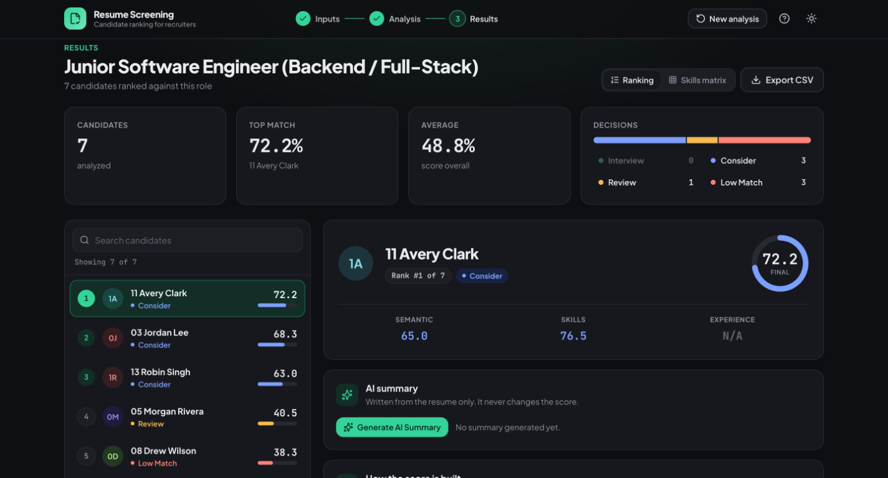
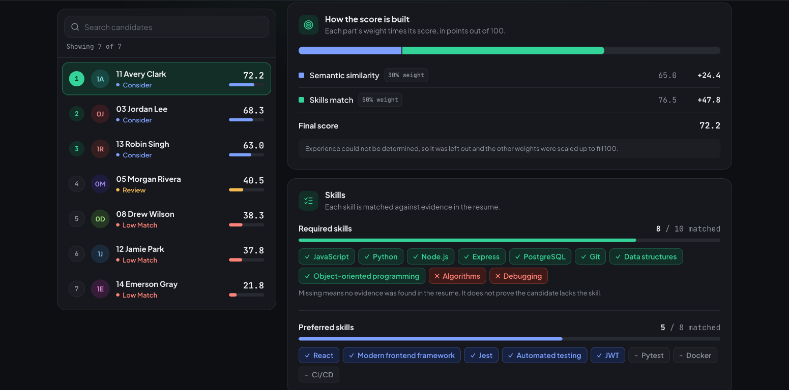

# Smart Resume Screening

> **Explainable, AI-assisted candidate screening for human decision-makers.**

Smart Resume Screening compares job descriptions with one or more PDF resumes, extracts structured evidence, and produces transparent candidate-ranking signals. It is designed to help recruiters review applications faster—not to replace human judgment.

**Live frontend:** [ashishbaddie.github.io/smart-resume-screening](https://ashishbaddie.github.io/smart-resume-screening/)

The GitHub Pages deployment includes a clearly labeled demo fallback with sample candidates. Recruiters can click **“Try with 3 sample resumes”** to load a sample role, three candidates, and an end-to-end ranking preview in one step. Live PDF analysis requires the separately deployed FastAPI backend.

[](frontend/)
[](api/)
[](requirements.txt)
[](docker-compose.yml)

## At a glance

| Capability | What it provides |
| --- | --- |
| **Job understanding** | Extracts required skills, preferred skills, experience, and education from a job description |
| **Resume analysis** | Parses and validates one or multiple PDF resumes |
| **Explainable matching** | Combines semantic similarity, skill evidence, and experience |
| **Candidate ranking** | Sorts candidates with score breakdowns and decision labels |
| **Recruiter workflow** | Supports AI-generated summaries and CSV export |
| **Fairness checks** | Includes a synthetic audit for name and age cues |

## Product tour

### 1. Add the role and resumes

Provide a job description, upload resumes, and start an analysis run.


### 2. Review ranked candidates

Compare candidates using the overall score, match label, and extracted evidence.



### 3. Understand every score

Open a candidate to inspect the factors behind the recommendation.



## How scoring works

The final score is calculated from:

- **30%** semantic similarity between the job description and resume
- **50%** required and preferred skill match
- **20%** experience match

If experience is not specified or cannot be determined, that component is re-normalized instead of treating unknown experience as zero.

| Score | Guidance |
| ---: | --- |
| **80–100** | Interview |
| **60–79.99** | Consider |
| **40–59.99** | Review |
| **Below 40** | Low Match |

These labels are decision-support guidance only. Recruiters should review the underlying evidence and follow applicable employment, privacy, and anti-discrimination requirements.

## Architecture

```text
React + TypeScript + Tailwind
              │
              ▼
        FastAPI REST API
              │
              ▼
      Background analysis jobs
              │
              ▼
 PDF parsing + Gemini extraction
       + Sentence Transformers
```

| Layer | Technologies |
| --- | --- |
| Frontend | React 18, TypeScript, Vite, Tailwind CSS |
| Backend | Python, FastAPI, Pydantic |
| AI/NLP | Google Gemini, Sentence Transformers |
| Documents | pdfplumber |
| Testing | pytest, Vitest |
| Deployment | Docker, Docker Compose |

## Quick start with Docker

### 1. Configure the API key

```bash
cp .env.example .env
```

Set your Gemini key in `.env`:

```env
GEMINI_API_KEY=your_gemini_api_key
```

### 2. Start the application

```bash
docker compose up --build
```

Open the application at **[http://localhost:8080](http://localhost:8080)**.

| Service | URL |
| --- | --- |
| Web application | [localhost:8080](http://localhost:8080) |
| API | [localhost:8000](http://localhost:8000) |
| Interactive API docs | [localhost:8000/docs](http://localhost:8000/docs) |

## Run locally

### Backend

```bash
python -m venv .venv
source .venv/bin/activate
python -m pip install -r api/requirements.txt
GEMINI_API_KEY=test uvicorn api.main:app --reload --port 8000
```

### Frontend

```bash
cd frontend
npm install
npm run dev
```

The Vite development server runs at [localhost:5173](http://localhost:5173) and proxies API requests to port `8000`.

### Optional Streamlit interface

The original Streamlit interface is still available for lightweight local use:

```bash
streamlit run app.py
```

## Bias and fairness audit

The [`bias_audit/`](bias_audit/) workflow tests whether the same resume score changes when only name or age cues change. It generates synthetic variants, measures run-to-run score noise, and reports material differences.

This is an indicative technical check using a small synthetic sample—not proof of fairness, absence of bias, or legal compliance. See [`bias_audit/README.md`](bias_audit/README.md) for instructions.

## Privacy and AI disclosure

Gemini extracts structured information from resumes and job profiles and can generate candidate summaries. Resume text is therefore sent to the Gemini API.

- Use only resumes you are authorized to process.
- The API keeps jobs in memory and does not write resume text to disk.
- Jobs expire and can be deleted by the client.
- Keep `GEMINI_API_KEY` server-side; never expose it through a `VITE_*` variable.

## GitHub Pages frontend

The React frontend can be deployed with [`.github/workflows/deploy-pages.yml`](.github/workflows/deploy-pages.yml).

1. In **Settings → Pages**, select **GitHub Actions** as the source.
2. Add the `VITE_API_BASE_URL` repository variable under **Settings → Secrets and variables → Actions → Variables**.
3. Push to `main` or run the workflow manually.

GitHub Pages hosts **only the React frontend**. The FastAPI backend must be deployed separately and connected through `VITE_API_BASE_URL`; the Gemini API key must remain on the backend.

## Testing

### Python

```bash
GEMINI_API_KEY=test python -m pytest tests -q
```

External Gemini and embedding-model calls are mocked in the test suite.

### Frontend

```bash
cd frontend
npm test
npm run build
```

## Project structure

```text
api/                  FastAPI routes, jobs, schemas, and services
frontend/             React application
models/               Pydantic response and extraction models
src/                  Analysis, matching, and PDF parsing logic
tests/                Python unit and API tests
bias_audit/           Synthetic bias-testing scripts and reports
screenshots/          Product screenshots
data/                 Runtime skill vocabulary
docs/                 API and architecture documentation
```

## Limitations

- Gemini availability and API quota can affect extraction.
- PDF text quality depends on document format and layout.
- Scanned, image-only resumes may require OCR.
- Extracted evidence and model outputs may contain errors.
- The synthetic bias audit should not be generalized to a legal or demographic audit.
- The in-memory job store is intended for single-server use.
