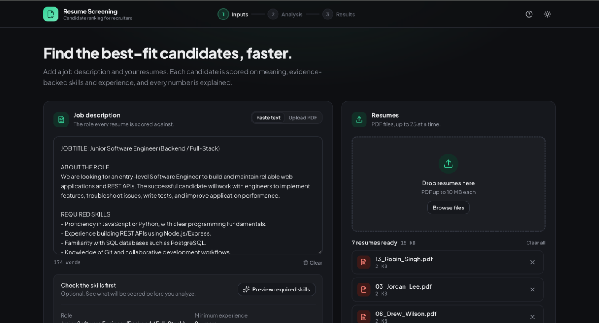
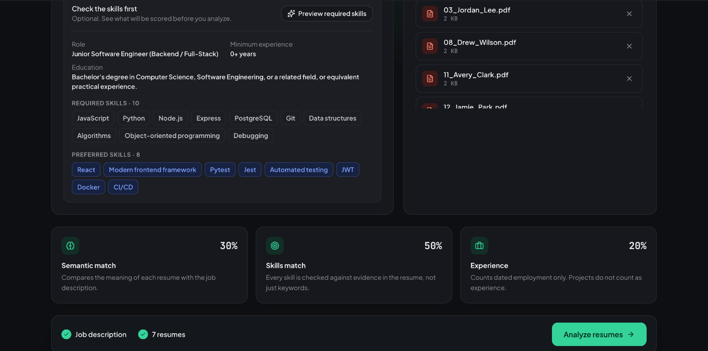
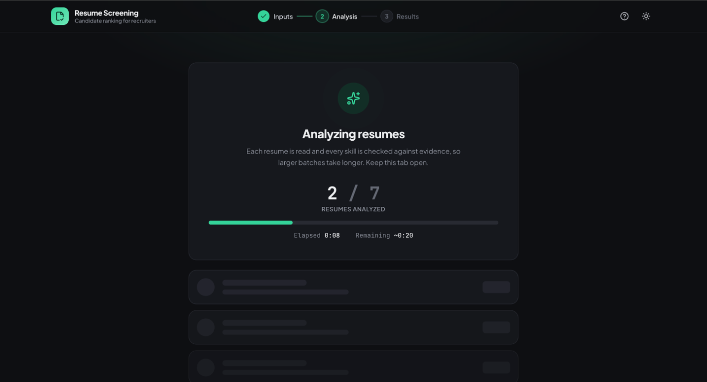
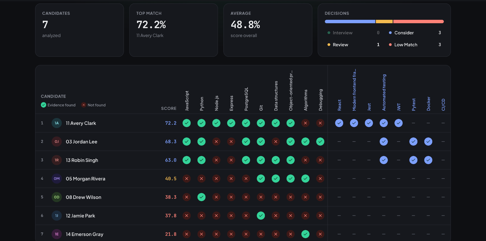

# Smart Resume Screening

AI-assisted resume screening and candidate-ranking platform that compares PDF resumes with a job description and produces explainable decision-support scores.

> **Responsible use:** This system provides decision-support signals only. It does not make hiring decisions. Recruiters should review candidate evidence and follow applicable employment and privacy laws.

## Screenshots

### Job description, resume uploads, and analysis inputs



### Extracted job profile and skill preview



### Background resume analysis



### Ranked candidate results


### Explainable score breakdown


### Candidate skills matrix



## Features

- Extracts a job profile from pasted text or a PDF
- Reviews required skills, preferred skills, experience, and education
- Parses and validates one or multiple resume PDFs
- Uses evidence-backed skill matching rather than keyword-only matching
- Calculates semantic similarity, skills, and experience scores
- Ranks candidates and provides a clear decision label
- Generates on-demand AI summaries
- Exports ranking results as CSV
- Includes a synthetic bias audit for name and age cues

## Project views

### React and FastAPI

The recommended deployment uses React, FastAPI, and Docker:

- React application: `http://localhost:8080`
- API: `http://localhost:8000`
- Interactive API documentation: `http://localhost:8000/docs`

### Streamlit

A Streamlit interface is also available:

```bash
streamlit run app.py
```

## Architecture

```text
React / TypeScript / Tailwind
          |
       REST API
          |
FastAPI background jobs
          |
ResumeAnalyzer + Pydantic models
          |
PDF parsing + Gemini extraction + Sentence Transformers
```

- **Frontend:** React 18, TypeScript, Vite, Tailwind CSS
- **Backend:** Python, FastAPI, Pydantic
- **AI and NLP:** Google Gemini and Sentence Transformers
- **PDF processing:** pdfplumber
- **Testing:** pytest and Vitest
- **Deployment:** Docker and Docker Compose

## How scoring works

The final candidate score is a weighted combination:

- 30% job-description and resume semantic similarity
- 50% required and preferred skill match
- 20% experience match

The experience component is re-normalized if experience is not specified or cannot be determined. Unknown experience is not treated as zero.

Decision labels are:

| Final score | Decision |
|---|---|
| 80–100 | Interview |
| 60–79.99 | Consider |
| 40–59.99 | Review |
| Below 40 | Low Match |

These thresholds are guidance for human review and should not be used as an automatic selection mechanism.

## Bias and fairness audit

The [bias_audit/](/Users/ashishpal/smart-resume-screening/bias_audit) workflow checks whether the same resume score changes when only name or age cues change.

It generates 40 synthetic resume PDFs:

- Original and duplicate copies
- Female and male name variants
- Different surnames
- Age cues of 22 and 38

Run-to-run score noise is measured and used as a tolerance for identifying material changes. The included audit is an **indicative technical check using a small synthetic sample**; it is not a proof of fairness or compliance.

See [bias_audit/README.md](/Users/ashishpal/smart-resume-screening/bias_audit/README.md) for usage instructions.

## Privacy and AI disclosure

Gemini is used to extract structured resume and job-profile information and to generate candidate summaries. Resume text is therefore sent to the Gemini API.

Do not upload personal or confidential resumes without appropriate consent and organizational approval. The API uses in-memory jobs and does not write resume text to disk. Jobs expire and can be deleted by the client.

## Run with Docker

Create a local environment file:

```bash
cp .env.example .env
```

Set a valid Google Gemini API key in `.env`:

```text
GEMINI_API_KEY=your_gemini_api_key
```

Start the application:

```bash
docker compose up --build
```

Open `http://localhost:8080`. API documentation is available at `http://localhost:8000/docs`.

## Run locally

### Backend

```bash
python -m venv .venv
source .venv/bin/activate
python -m pip install -r api/requirements.txt
GEMINI_API_KEY=test uvicorn api.main:app --reload --port 8000
```

### Frontend

```bash
cd frontend
npm install
npm run dev
```

The frontend development server is available at `http://localhost:5173` and proxies API requests to port 8000.

## GitHub Pages frontend

The React frontend can be deployed automatically by [.github/workflows/deploy-pages.yml](/Users/ashishpal/smart-resume-screening/.github/workflows/deploy-pages.yml).

1. In GitHub, open **Settings > Pages** and select **GitHub Actions** as the source.
2. In **Settings > Secrets and variables > Actions > Variables**, add:
   - `VITE_API_BASE_URL`: the deployed FastAPI base URL, such as `https://your-api.onrender.com`
3. Push to `main` or run the workflow manually.

The frontend will be published at `https://ashishbaddie.github.io/smart-resume-screening/`.
The Gemini API key must remain server-side and must not be placed in a `VITE_*` variable.

## Tests

### Python

```bash
GEMINI_API_KEY=test python -m pytest tests -q
```

The test suite mocks external Gemini and embedding-model calls.

### Frontend

```bash
cd frontend
npm test
npm run build
```

## Project structure

```text
api/                  FastAPI routes, jobs, schemas, and API services
frontend/             React application
models/               Pydantic response and extraction models
src/
  analysis/           Resume scoring and LLM extraction
  matching/           Skill and semantic matching
  parsers/            PDF text extraction
tests/                Python unit and API tests
bias_audit/           Synthetic bias-testing scripts and reports
screenshots/          Application screenshots
data/                 Runtime skill vocabulary
docs/                 API and architecture documentation
```

## Limitations

- Gemini availability and API quota can affect extraction
- PDF text quality depends on the document format and layout
- Scanned, image-only resumes may require OCR
- Scores are based on extracted evidence and may contain model errors
- Bias results use synthetic test resumes and should not be generalized as a legal or demographic audit
- The in-memory job store is intended for single-server use
